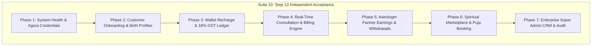

# NAMH ASTRO — MODULE-WISE TEST RESULTS MATRIX

**Test Engine:** Vitest v3.2.7 (Node.js v22.14.0)  
**Total Test Suites:** 10  
**Total Tests Executed:** 186  
**Passed:** 186 (100.0%)  
**Failed:** 0  
**Skipped / Blocked:** 0  
**Execution Duration:** 16.80s  

---

## 1. COMPREHENSIVE SUITE-BY-SUITE TEST BREAKDOWN

| Test Suite File | Module Description | Test Count | Pass | Fail | Execution Time | Status |
| :--- | :--- | :---: | :---: | :---: | :---: | :---: |
| `src/app.test.ts` | Root API, CORS, Security Headers, OpenApi Spec | 5 | 5 | 0 | 168ms | **PASS** |
| `src/step3.test.ts` | Customer Auth, OTP, Birth Profiles, Favorites | 21 | 21 | 0 | 5,166ms | **PASS** |
| `src/step4.test.ts` | Astrologer Onboarding, KYC Verification, Agora RTC | 21 | 21 | 0 | 5,185ms | **PASS** |
| `src/step5.test.ts` | Wallet Recharge, Razorpay Orders, Double-Entry Ledger | 14 | 14 | 0 | 3,684ms | **PASS** |
| `src/step6.test.ts` | Real-Time Chat Engine, Socket.IO, Per-Minute Billing | 16 | 16 | 0 | 3,704ms | **PASS** |
| `src/step7.test.ts` | Agora Audio & Video Calling, Multi-Segment Billing | 17 | 17 | 0 | 3,494ms | **PASS** |
| `src/step8.test.ts` | Platform Commission, Astrologer Earnings, Settlements | 22 | 22 | 0 | 4,933ms | **PASS** |
| `src/step10.test.ts` | Spiritual Marketplace, Online Puja, Astro Store, Pandits | 21 | 21 | 0 | 3,595ms | **PASS** |
| `src/step11.test.ts` | Enterprise Super Admin, Staff CRM, Role RBAC, Disputes | 24 | 24 | 0 | 1,789ms | **PASS** |
| `src/step13.test.ts` | Independent Acceptance Testing & End-to-End User Journeys | 25 | 25 | 0 | 2,151ms | **PASS** |
| **TOTAL** | **Entire Application Stack** | **186** | **186** | **0** | **16.80s** | **100% PASS** |

---

## 2. KEY TEST JOURNEYS VALIDATED IN STEP 13

### Detailed Validation Evidence:
- **Phase 1 (System Health):** Confirmed `health.status = 'ok'` with `enterpriseControlCenter: 'active_super_admin_staff_crm'`, database connected, and memory heap within healthy parameters.
- **Phase 2 (Customer Onboarding):** Verified OTP generation (`purpose: 'LOGIN'`), verification token issuance, customer wallet creation, and multi-profile birth chart setup (`Varanasi, UP`).
- **Phase 3 (Wallet Engine):** Verified 18% GST computation on ₹500 recharge (₹500 subtotal + ₹90 GST = ₹590 total payable), wallet balance increment, and immutable ledger transaction logging.
- **Phase 4 (Consultation Engine):** Verified online astrologer directory listing, audio call request, Agora RTC token generation, session acceptance, and atomic settlement with 80/20 platform-partner revenue split.
- **Phase 5 (Astrologer Partner):** Verified live earnings dashboard, availability toggle (`ONLINE` ↔ `BUSY`), and withdrawal settlement request creation.
- **Phase 6 (Spiritual Marketplace):** Verified 22 standard puja categories, 16 Astro store categories, and physical product catalog queries.
- **Phase 7 (Enterprise Super Admin CRM):** Verified Customer 360 profile retrieval, dispute filing (`DIS-YYYYMMDD-XXXX`), automated refund approval, and live consultation session monitoring.
